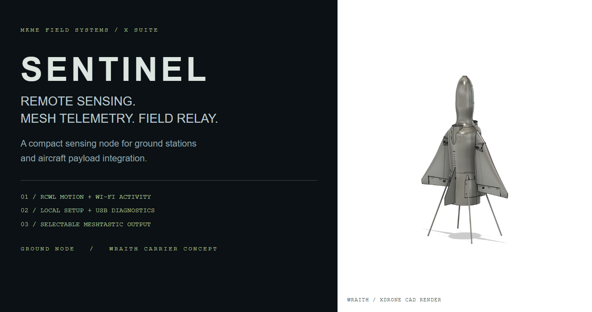
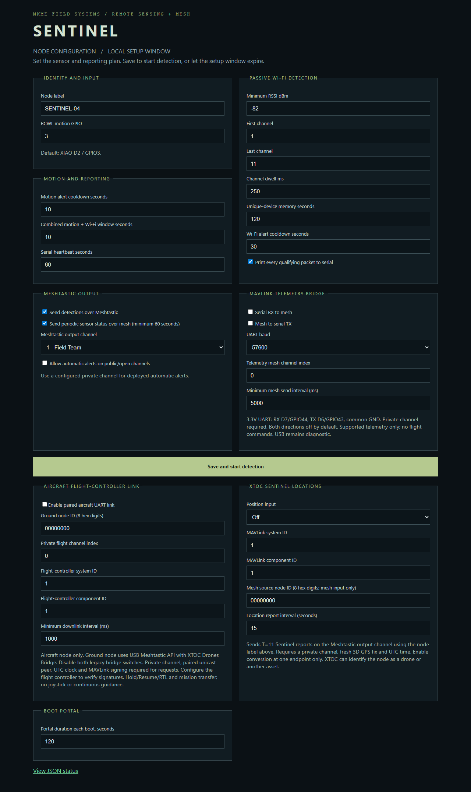
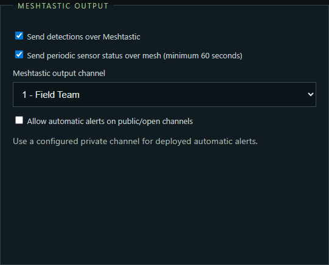
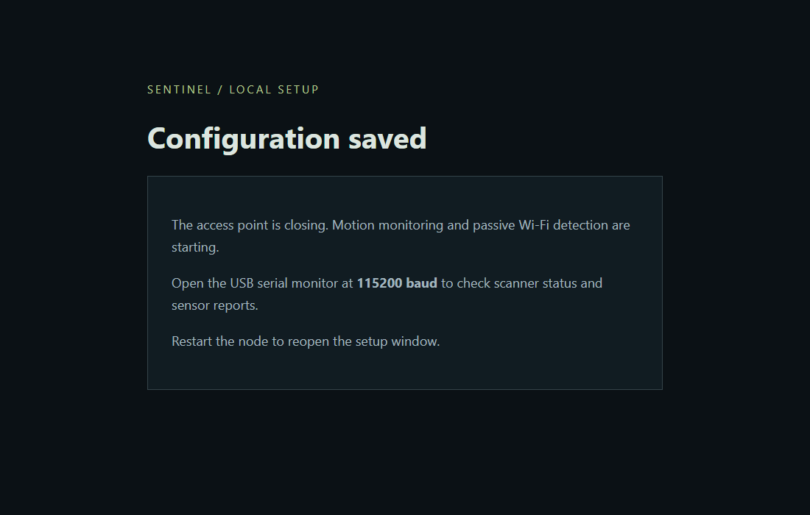
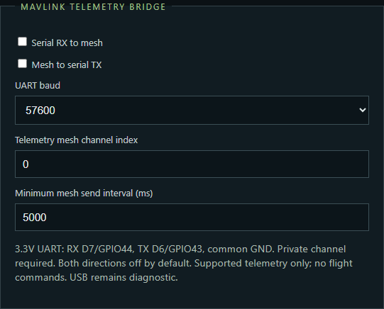
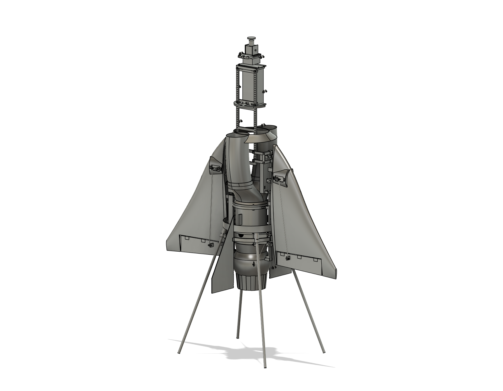
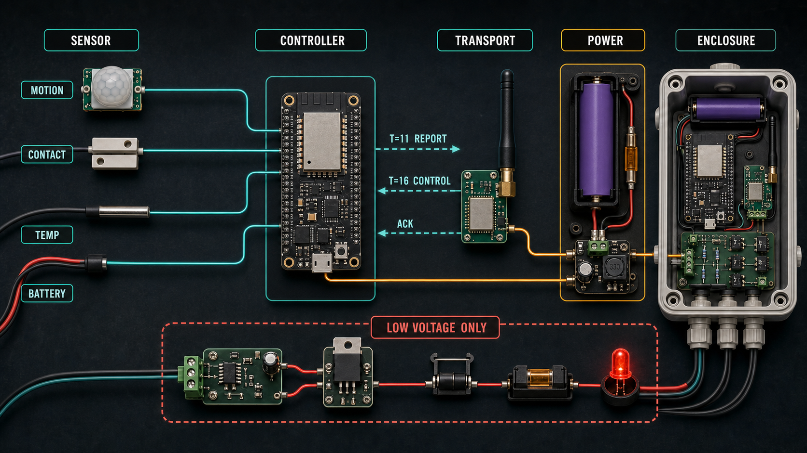
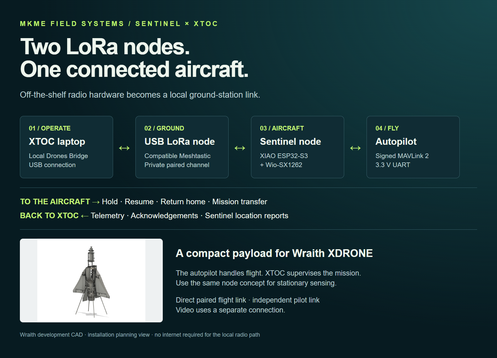
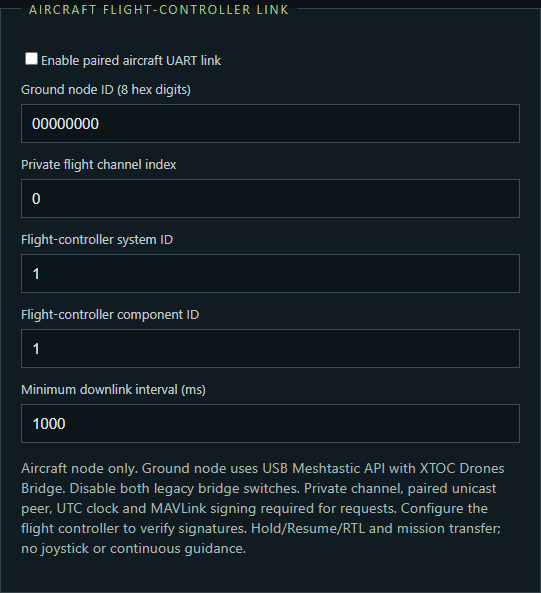
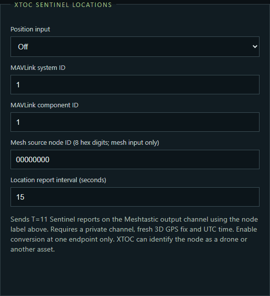

# Sentinel



**Remote sensing. Mesh telemetry. Field relay.** Sentinel is the remote-sensing branch of the XNODE field-device concept, maintained in this repository for the MKME X Suite. Deploy a stationary sensor node or integrate a compact sensing and communications payload into an aircraft such as **Wraith XDRONE**.

The **XIAO ESP32-S3 + Wio-SX1262** firmware combines RCWL-0516 motion sensing, passive Wi-Fi activity detection, USB diagnostics, selectable Meshtastic reports and two selectable MAVLink modes: a low-rate telemetry bridge or a paired flight-controller link. Standard Meshtastic forwarding provides the relay function according to the configured device role, hop limit and radio settings.

The original Arduino examples remain available for direct `T=11 SENTINEL` import into XTOC and XCOM. The Presence firmware sends **Meshtastic sensor alerts, optional status messages and optional MAVLink-derived `T=11` location reports** for XTOC ingestion.

Repository: <https://github.com/MKme/sentinel>

> Sentinel is an awareness aid, not a certified alarm, security, fire, medical, or life-safety system. Do not wire sensor outputs to mains, machinery, vehicle controls or hazardous loads. Aircraft supervision uses the explicitly configured paired MAVLink interface described below.

## Field roles

| Role | Use |
| --- | --- |
| Ground sensing station | Monitor a gate, equipment site or stationary observation point for motion and nearby Wi-Fi activity. |
| Mesh relay | Participate in the configured Meshtastic network and forward eligible packets. Antenna placement, terrain, role and channel settings determine coverage. |
| Wraith sensing payload | Carry the small node as a separate payload; use its mesh link for sensor reports while retaining an independent flight-control system. |
| Bench diagnostics | Inspect activity, signal strength, Wi-Fi channel, motion transitions, queue drops and scanner status over USB at 115200 baud. |

Wi-Fi activity is a radio observation, not a person count or device identity. RCWL motion sensing is intended for a stationary or landed installation; movement of the aircraft changes the sensor's reference and can produce motion indications.

## Configure the Presence node

1. Power the node and join **`SENTINEL-xxxx`** within the boot setup window—**120 seconds** by default. The factory setup password is **`sentinel123`**. Configure in a controlled location; this is a local commissioning interface.
2. Open **`http://192.168.4.1`**. Set a recognizable node label, motion input, Wi-Fi threshold and reporting intervals. The portal needs no internet, external fonts or scripts.



*Firmware setup-page capture with example settings and simulated Meshtastic channel names. [Full-size screen](assets/presence/setup-desktop.png) · [Phone layout](assets/presence/setup-mobile.png).*

3. Choose **Send detections over Meshtastic** and the configured output channel. Optionally enable periodic sensor status. Configure the actual channel keys, RF region, modem preset and device role using the Meshtastic app over Bluetooth. This portal selects an existing channel; it does not create or key one.



*Example channel selection. Public/open or well-known-key channels require explicit opt-in; disabled channels and an unconfigured radio cannot send Sentinel reports. Turning off Sentinel output leaves normal Meshtastic operation intact.*

4. Select **Save and start detection**. Settings are retained in flash. The access point closes and scanning begins. Without a save, the node starts with its saved settings when the setup window expires. Restart to reopen setup.



*Firmware confirmation-page capture. Check the serial scanner status after this screen; a saved configuration does not confirm reception at another mesh node.*

Example mesh messages:

```text
SENTINEL-04: WIFI DETECTED RSSI -58 WIFI-CH 6
SENTINEL-04: MOTION DETECTED
SENTINEL-04: MOTION+WIFI DETECTED
SENTINEL-04: ONLINE WIFI 12 MOTION 0 SCAN OK
```

`WIFI` in the periodic report is the cumulative count of deduplicated observations since boot, not a current device population. The serial `mesh_submitted` message means the packet was handed to Meshtastic; verify arrival on the receiving node.

**[Presence firmware, wiring and local build](firmware/SentinelPresenceMeshtastic/README.md)**

## MAVLink telemetry over mesh

Enable **Serial RX to mesh**, **Mesh to serial TX**, or both in the boot portal. The bridge uses a separate 3.3 V UART: **D7/GPIO44 RX**, **D6/GPIO43 TX**, common **GND**. Cross TX to RX at the connected device; USB remains the diagnostic console. Set the UART baud to match your telemetry device (default **57600**, 8N1).



*Source-rendered setup controls with simulated settings. Both directions default off. [Full-size bridge controls](assets/presence/mavlink-bridge.png).*

On the aircraft or sensor side, enable serial RX to mesh. On the receiving side, enable mesh to serial TX and connect the UART to your telemetry display or a suitable USB-UART adapter. Use the same configured private Meshtastic channel/key on both nodes and select its local channel index on each. Configure keys and RF settings through Meshtastic Bluetooth. A public/default-key channel is blocked for MAVLink regardless of the sensor-alert opt-in.

Supported MAVLink 1/2 telemetry: **HEARTBEAT, SYS_STATUS, GPS_RAW_INT, ATTITUDE and GLOBAL_POSITION_INT**. Checksums are validated; accepted frames, including MAVLink 2 signature bytes, are forwarded unchanged. Signature authentication remains the receiving MAVLink endpoint's responsibility. Flight commands, parameter/mission transfers and other message types are excluded.

The bridge sends at most one frame per configured interval (**5 seconds** by default), rotating among the latest observations of each supported type. This is low-rate situational telemetry, not a full-rate flight link. Both endpoints need this bridge firmware; ordinary Meshtastic text messages are not decoded as MAVLink. See [wiring, message format and bench checks](firmware/SentinelPresenceMeshtastic/README.md#mavlink-serial--mesh-bridge).

## Wraith / XDRONE payload integration



*Wraith development CAD. The image shows the aircraft architecture, not a fitted Sentinel installation.*

Treat Sentinel as a separately powered and secured sensing/communications payload. Plan a suitable regulated supply, antenna clearance, access to USB and the setup window, strain relief and a mount that preserves aircraft balance and cooling. Keep the node and wiring clear of the EDF, servos and flight-control connections. Verify interference and sensing behavior with the propulsion system operating before an airborne installation.

The legacy SMV1 telemetry bridge forwards supported telemetry only. Select the separate paired SMF1 flight-controller mode for signed XTOC Hold/Resume/RTL and mission transfer through a USB ground node. Aircraft payload fit and flight acceptance are separate from the sensing code. [Full aircraft CAD view](assets/presence/wraith-cad.png).

## What you can build

- gate, door, cabinet, or equipment-case contact node
- PIR or RCWL motion cue
- shelter, freezer, generator-compartment, or outdoor temperature node
- battery-health and remote-power heartbeat
- combined multi-sensor node with a stable name and map position
- optional low-voltage output demonstrator using `T=16 CONTROL` and acknowledgement



## Standalone sensor learning example

Start with an ESP32 DevKit and one HC-SR501 PIR. The supplied sketch needs no third-party Arduino library.

| Part | Connect to ESP32 |
| --- | --- |
| HC-SR501 `VCC` | board `5V/VIN` when the module requires 5 V |
| HC-SR501 `GND` | `GND` |
| HC-SR501 `OUT` | GPIO `4` |

1. Install Arduino IDE and the Espressif ESP32 board package.
2. Open [`arduino/SentinelClearDemo/SentinelClearDemo.ino`](arduino/SentinelClearDemo/SentinelClearDemo.ino).
3. Set `NODE_ID`, `LABEL`, `LAT`, and `LON` near the top.
4. Select the exact ESP32 board and serial port.
5. Upload, open Serial Monitor at `115200`, and wait for an `X1.11.C...` line.
6. In XTOC or XCOM, open `Comms -> Import/Export`, paste the complete line, and import it.
7. Confirm the report appears in `Sentinel` and on the Tactical Map Sentinel layer.
8. Walk-test the PIR, then test stillness, sunlight changes, warm-up, and the planned mounting position.

## USB ground station and flight-controller link



**Build with familiar parts:** a compatible Meshtastic USB ground radio, XIAO ESP32-S3 + Wio-SX1262 aircraft node and the autopilot's MAVLink UART. No cellular service or cloud relay is needed for this local path. LoRa carries compact commands and telemetry; the autopilot handles stabilization and flight execution. The paired flight path is direct, not a multi-hop command mesh.

A USB-connected ground node can carry XTOC supervised commands over LoRa to an aircraft Sentinel and return its MAVLink telemetry. The separate paired flight mode supports Hold/Resume/RTL and mission transfer with existing XTOC operator authorization and end-to-end MAVLink signing.



*Source-rendered settings, disabled by default. [Ground station, wiring and control setup](wiki/Flight-Controller-Link.md). This is a low-bandwidth supervision link; continuous joystick/VECTOR control and video use separate links.*

## Drone and ground-node location reports

Select serial UART or a specific mesh MAVLink source in **XTOC Sentinel locations**. Set a label such as `WRAITH-01`, the source system/component IDs and reporting interval. Fresh 3D GPS fixes become standard Sentinel position packets, with a stable node ID, over the selected private mesh channel. XTOC can auto-import them through its existing mesh packet path.



*Source-rendered firmware controls with simulated settings. [Setup, wiring and verification guide](wiki/Presence-and-MAVLink.md).*

## Code included

| Sketch | Purpose |
| --- | --- |
| [`SentinelPresenceMeshtastic`](firmware/SentinelPresenceMeshtastic/README.md) | XIAO ESP32-S3/SX1262 sensing and mesh node with boot configuration portal, motion/Wi-Fi alerts, optional status reports and USB diagnostics |
| [`SentinelClearDemo.ino`](arduino/SentinelClearDemo/SentinelClearDemo.ino) | reads a motion input, builds the binary Sentinel v1 payload, base64url-encodes it, and prints a complete clear `T=11` wrapper |
| [`SentinelControlDemo.ino`](arduino/SentinelControlDemo/SentinelControlDemo.ino) | decodes clear `T=16 CONTROL`, applies an 8-bit low-voltage output bank, and emits a `T=11` acknowledgement with the resulting `outMask` |

The demos are intentionally self-contained so builders can see the entire packet implementation without hidden libraries. Copy a demo before adapting it for a deployed node.

PlatformIO users can build either self-contained project directly:

```powershell
pio run -d arduino/SentinelClearDemo
pio run -d arduino/SentinelControlDemo
```

## Optional standalone sensor parts

The links below are Amazon search links carrying affiliate tag `wbca-20`; availability and sellers change. Match voltage, pinout, dimensions, and chemistry before ordering.

### Core starter kit

- [ESP32 DevKit V1 boards](https://www.amazon.com/s?k=ESP32+DevKit+V1&tag=wbca-20)
- [HC-SR501 PIR motion sensors](https://www.amazon.com/s?k=HC-SR501+PIR+motion+sensor&tag=wbca-20)
- [magnetic reed contact switches](https://www.amazon.com/s?k=magnetic+reed+contact+switch+wired&tag=wbca-20)
- [waterproof DS18B20 temperature probes](https://www.amazon.com/s?k=waterproof+DS18B20+temperature+sensor&tag=wbca-20)
- [solderless breadboard and jumper kit](https://www.amazon.com/s?k=electronics+breadboard+jumper+wire+kit&tag=wbca-20)
- [USB data cables for ESP32](https://www.amazon.com/s?k=USB+data+cable+ESP32&tag=wbca-20)

### Deployable enclosure and power

- [weather-resistant project enclosures](https://www.amazon.com/s?k=waterproof+electrical+project+enclosure&tag=wbca-20)
- [IP-rated cable glands](https://www.amazon.com/s?k=waterproof+cable+glands+assortment&tag=wbca-20)
- [protected 18650 battery holders with switch](https://www.amazon.com/s?k=protected+18650+battery+holder+with+switch&tag=wbca-20)
- [quality protected 18650 cells](https://www.amazon.com/s?k=protected+18650+rechargeable+battery&tag=wbca-20)
- [5 V USB power banks](https://www.amazon.com/s?k=USB+power+bank+5V&tag=wbca-20)
- [inline low-voltage fuse holders](https://www.amazon.com/s?k=inline+low+voltage+fuse+holder&tag=wbca-20)
- [heat-shrink tubing kit](https://www.amazon.com/s?k=heat+shrink+tubing+kit&tag=wbca-20)
- [digital multimeter](https://www.amazon.com/s?k=digital+multimeter+electronics&tag=wbca-20)

Do not charge loose lithium cells with improvised wiring. Use protected cells, a chemistry-compatible certified charger/power module, fusing, and an enclosure that prevents shorts and crushing.

## Sensor conventions

| Type | Meaning | Stored value |
| --- | --- | --- |
| `1` | RCWL-0516 motion | `0` or `1` |
| `2` | PIR motion | `0` or `1` |
| `6` | temperature | degrees Celsius × 10 |
| `7` | battery | millivolts |

`T=11` can also carry `inMask`, `outMask`, a label, location, node ID, and an alert flag. Additional sensor type values from `0..255` can be assigned by a team convention.

## Documentation

- [Flight-controller setup: USB ground station, pairing and mission supervision](wiki/Flight-Controller-Link.md)
- [Online illustrated setup guide](https://www.mkme.org/xtoc/guides/sentinel-flight-link.html) · [Printable PDF](https://www.mkme.org/xtoc/guides/sentinel-flight-link.pdf)

- [Wiki home](wiki/Home.md)
- [Parts and kits](https://github.com/MKme/sentinel/blob/main/wiki/Parts-and-Kits.md)
- [Build the first node](https://github.com/MKme/sentinel/blob/main/wiki/Build-the-First-Node.md)
- [Wiring reference](https://github.com/MKme/sentinel/blob/main/wiki/Wiring-Reference.md)
- [XTOC and XCOM integration](https://github.com/MKme/sentinel/blob/main/wiki/XTOC-XCOM-Integration.md)
- [Deployment and troubleshooting](https://github.com/MKme/sentinel/blob/main/wiki/Deployment-and-Troubleshooting.md)
- [Packet and firmware notes](https://github.com/MKme/sentinel/blob/main/wiki/Packet-and-Firmware.md)

Current source-controlled [wiki files](wiki/Home.md), including the [Presence and MAVLink guide](wiki/Presence-and-MAVLink.md), are maintained here. These source-controlled pages are the maintained wiki documentation.

## Safe deployment checklist

- label the enclosure and software with the same stable node name
- record board, firmware revision, node ID, coordinates, power, and installation photo
- replace breadboard jumpers with soldered or locking connections
- strain-relieve cables and keep the antenna clear of metal
- test cold boot, power loss, transport loss, false triggers, and heartbeat silence
- verify every alert with a second source before dispatch or escalation
- keep a manual PACE fallback and a scheduled physical inspection

## X Suite

Sentinel reports are decoded by XTOC and XCOM. XTOC provides the Sentinel review page, Tactical Map layer, time-based triggers, label filters, temperature/battery thresholds, input/output-mask triggers, and `T=16 CONTROL` composition. XINTEL supplies local radio/SDR monitoring and packet ingest, while XCORE provides local AI-assisted analysis of XTOC/XCOM operational data.

- [XTOC](https://github.com/MKme/XTOC)
- [XCOM](https://github.com/MKme/xcom)
- [XINTEL](https://github.com/MKme/xintel) provides local radio/SDR monitoring, transcription, and packet ingest
- [XCORE](https://github.com/MKme/xcore) provides local AI-assisted summaries and operational analysis
- [XCAM](https://github.com/MKme/xcam) can also post camera-motion Sentinel reports
- [XNODE](https://github.com/MKme/xnode) provides wearable and keyboard field endpoints

## Radio and security note

The example sketches emit clear packets so they are easy to inspect and test. Use an appropriate authenticated/secure transport for real control where lawful. Encryption or obscured content may be prohibited on amateur radio; the operator is responsible for applicable rules.
