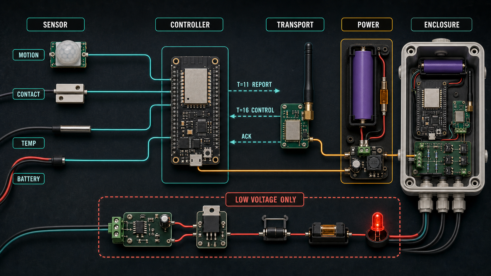
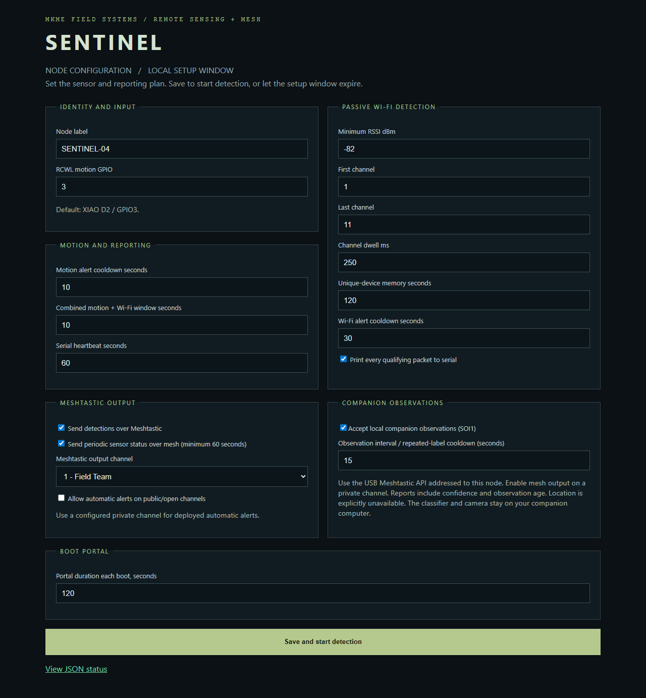
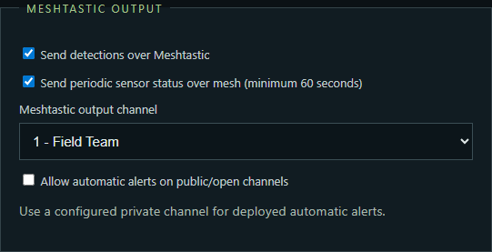
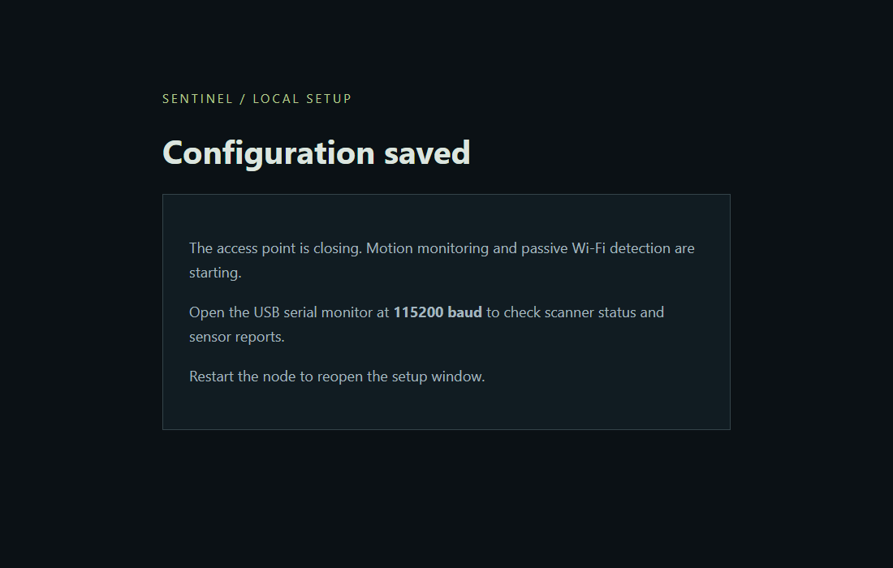

# Sentinel



**Local sensing. Mesh alerts. Field relay.** Sentinel is a standalone ground-sensor project for the MKME X Suite. Use it at a gate, equipment site or stationary observation point, without internet access.

The XIAO ESP32-S3 + Wio-SX1262 firmware combines RCWL-0516 motion sensing, passive Wi-Fi activity detection, USB diagnostics and selectable Meshtastic alerts. Standard Meshtastic forwarding follows the radio's configured role, hop limit and channel settings.

The Arduino examples provide direct `T=11 SENTINEL` import into XTOC and XCOM. Presence firmware provides readable sensor alerts and optional companion `T=11` observations.

## Companion object observations

Connect your own Raspberry Pi classifier over USB. Sentinel accepts a compact object label, confidence, count and observation ID, then sends a normal `T=11` alert over the private mesh. Companion reports explicitly mark location unavailable; missing UTC is marked unknown. Images and recognition software stay on your companion computer.

Start with the [companion input contract and generic sender](firmware/SentinelPresenceMeshtastic/OBSERVATIONS.md) or the [wiki setup](wiki/Companion-Observations.md). In XTOC, install **Sentinel Object Observation Alerts** from XPASS, then configure and enable the **SOA** templates in **Triggers**. The example plugins and rules start disabled. Use an updated XTOC receiver supporting observation quality fields.

> Sentinel is an awareness aid, not a certified alarm, security, fire, medical, or life-safety system. Do not wire sensor outputs to mains, machinery, vehicle controls or hazardous loads.

## Field roles

| Role | Use |
| --- | --- |
| Ground sensing station | Monitor a gate, equipment site or stationary observation point for motion and nearby Wi-Fi activity. |
| Mesh relay | Participate in the configured Meshtastic network and forward eligible packets. Antenna placement, terrain, role and channel settings determine coverage. |
| Bench diagnostics | Inspect activity, signal strength, Wi-Fi channel, motion transitions, queue drops and scanner status over USB at 115200 baud. |

Wi-Fi activity is a radio observation, not a person count or device identity. RCWL motion sensing needs a stationary installation; moving the sensor can produce motion indications.

## Configure the Presence node

1. Power the node and join **`SENTINEL-xxxx`** within the boot setup window—**120 seconds** by default. The factory setup password is **`sentinel123`**. Configure in a controlled location; this is a local commissioning interface.
2. Open **`http://192.168.4.1`**. Set a recognizable node label, motion input, Wi-Fi threshold and reporting intervals. The portal needs no internet, external fonts or scripts.



*Firmware setup-page capture with example settings and simulated Meshtastic channel names. [Full-size screen](assets/presence/setup-desktop.png) · [Phone layout](assets/presence/setup-mobile.png).*

3. Choose **Send detections over Meshtastic** and the configured output channel. Optionally enable periodic sensor status. Configure the actual channel keys, RF region, modem preset and device role using the Meshtastic app over Bluetooth. This portal selects an existing channel; it does not create or key one.



*Example channel selection. Public/open or well-known-key channels require explicit opt-in; disabled channels and an unconfigured radio cannot send Sentinel reports. Turning off Sentinel output leaves normal Meshtastic operation intact.*

4. Select **Save and start detection**. Settings are retained in flash. The access point closes and scanning begins. Without a save, the node starts with its saved settings when the setup window expires. Restart to reopen setup.



*Firmware confirmation-page capture. Check the serial scanner status after this screen; a saved configuration does not confirm reception at another mesh node.*

Example mesh messages:

```text
SENTINEL-04: WIFI DETECTED RSSI -58 WIFI-CH 6
SENTINEL-04: MOTION DETECTED
SENTINEL-04: MOTION+WIFI DETECTED
SENTINEL-04: ONLINE WIFI 12 MOTION 0 SCAN OK
```

`WIFI` in the periodic report is the cumulative count of deduplicated observations since boot, not a current device population. The serial `mesh_submitted` message means the packet was handed to Meshtastic; verify arrival on the receiving node.

**[Presence firmware, wiring and local build](firmware/SentinelPresenceMeshtastic/README.md)**

## What you can build

- gate, door, cabinet, or equipment-case contact node
- PIR or RCWL motion cue
- shelter, freezer, generator-compartment, or outdoor temperature node
- battery-health and remote-power heartbeat
- combined multi-sensor node with a stable name and map position
- optional low-voltage output demonstrator using `T=16 CONTROL` and acknowledgement


## Standalone sensor learning example

Start with an ESP32 DevKit and one HC-SR501 PIR. The supplied sketch needs no third-party Arduino library.

| Part | Connect to ESP32 |
| --- | --- |
| HC-SR501 `VCC` | board `5V/VIN` when the module requires 5 V |
| HC-SR501 `GND` | `GND` |
| HC-SR501 `OUT` | GPIO `4` |

1. Install Arduino IDE and the Espressif ESP32 board package.
2. Open [`arduino/SentinelClearDemo/SentinelClearDemo.ino`](arduino/SentinelClearDemo/SentinelClearDemo.ino).
3. Set `NODE_ID`, `LABEL`, `LAT`, and `LON` near the top.
4. Select the exact ESP32 board and serial port.
5. Upload, open Serial Monitor at `115200`, and wait for an `X1.11.C...` line.
6. In XTOC or XCOM, open `Comms -> Import/Export`, paste the complete line, and import it.
7. Confirm the report appears in `Sentinel` and on the Tactical Map Sentinel layer.
8. Walk-test the PIR, then test stillness, sunlight changes, warm-up, and the planned mounting position.

## Code included

| Sketch | Purpose |
| --- | --- |
| [`SentinelPresenceMeshtastic`](firmware/SentinelPresenceMeshtastic/README.md) | XIAO ESP32-S3/SX1262 sensing and mesh node with boot configuration portal, motion/Wi-Fi alerts, optional status reports and USB diagnostics |
| [`SentinelClearDemo.ino`](arduino/SentinelClearDemo/SentinelClearDemo.ino) | reads a motion input, builds the binary Sentinel v1 payload, base64url-encodes it, and prints a complete clear `T=11` wrapper |
| [`SentinelControlDemo.ino`](arduino/SentinelControlDemo/SentinelControlDemo.ino) | decodes clear `T=16 CONTROL`, applies an 8-bit low-voltage output bank, and emits a `T=11` acknowledgement with the resulting `outMask` |

The demos are intentionally self-contained so builders can see the entire packet implementation without hidden libraries. Copy a demo before adapting it for a deployed node.

PlatformIO users can build either self-contained project directly:

```powershell
pio run -d arduino/SentinelClearDemo
pio run -d arduino/SentinelControlDemo
```

## Optional standalone sensor parts

The links below are Amazon search links carrying affiliate tag `wbca-20`; availability and sellers change. Match voltage, pinout, dimensions, and chemistry before ordering.

### Core starter kit

- [ESP32 DevKit V1 boards](https://www.amazon.com/s?k=ESP32+DevKit+V1&tag=wbca-20)
- [HC-SR501 PIR motion sensors](https://www.amazon.com/s?k=HC-SR501+PIR+motion+sensor&tag=wbca-20)
- [magnetic reed contact switches](https://www.amazon.com/s?k=magnetic+reed+contact+switch+wired&tag=wbca-20)
- [waterproof DS18B20 temperature probes](https://www.amazon.com/s?k=waterproof+DS18B20+temperature+sensor&tag=wbca-20)
- [solderless breadboard and jumper kit](https://www.amazon.com/s?k=electronics+breadboard+jumper+wire+kit&tag=wbca-20)
- [USB data cables for ESP32](https://www.amazon.com/s?k=USB+data+cable+ESP32&tag=wbca-20)

### Deployable enclosure and power

- [weather-resistant project enclosures](https://www.amazon.com/s?k=waterproof+electrical+project+enclosure&tag=wbca-20)
- [IP-rated cable glands](https://www.amazon.com/s?k=waterproof+cable+glands+assortment&tag=wbca-20)
- [protected 18650 battery holders with switch](https://www.amazon.com/s?k=protected+18650+battery+holder+with+switch&tag=wbca-20)
- [quality protected 18650 cells](https://www.amazon.com/s?k=protected+18650+rechargeable+battery&tag=wbca-20)
- [5 V USB power banks](https://www.amazon.com/s?k=USB+power+bank+5V&tag=wbca-20)
- [inline low-voltage fuse holders](https://www.amazon.com/s?k=inline+low+voltage+fuse+holder&tag=wbca-20)
- [heat-shrink tubing kit](https://www.amazon.com/s?k=heat+shrink+tubing+kit&tag=wbca-20)
- [digital multimeter](https://www.amazon.com/s?k=digital+multimeter+electronics&tag=wbca-20)

Do not charge loose lithium cells with improvised wiring. Use protected cells, a chemistry-compatible certified charger/power module, fusing, and an enclosure that prevents shorts and crushing.

## Sensor conventions

| Type | Meaning | Stored value |
| --- | --- | --- |
| `1` | RCWL-0516 motion | `0` or `1` |
| `2` | PIR motion | `0` or `1` |
| `6` | temperature | degrees Celsius × 10 |
| `7` | battery | millivolts |

`T=11` can also carry `inMask`, `outMask`, a label, location, node ID, and an alert flag. Additional sensor type values from `0..255` can be assigned by a team convention.

## Documentation


- [Wiki home](wiki/Home.md)
- [Passive Wi-Fi detection](wiki/Wi-Fi-Detection.md)
- [Configuration defaults and ranges](wiki/Configuration-Reference.md)
- [Build and flash Presence firmware](wiki/Build-and-Flash.md)
- [Companion observations and SOI1 input](wiki/Companion-Observations.md)
- [Standalone Arduino examples](wiki/Standalone-Examples.md)
- [Parts and kits](https://github.com/MKme/sentinel/blob/main/wiki/Parts-and-Kits.md)
- [Build the first node](https://github.com/MKme/sentinel/blob/main/wiki/Build-the-First-Node.md)
- [Wiring reference](https://github.com/MKme/sentinel/blob/main/wiki/Wiring-Reference.md)
- [XTOC and XCOM integration](https://github.com/MKme/sentinel/blob/main/wiki/XTOC-XCOM-Integration.md)
- [Deployment and troubleshooting](https://github.com/MKme/sentinel/blob/main/wiki/Deployment-and-Troubleshooting.md)
- [Packet and firmware notes](https://github.com/MKme/sentinel/blob/main/wiki/Packet-and-Firmware.md)


## Safe deployment checklist

- label the enclosure and software with the same stable node name
- record board, firmware revision, node ID, coordinates, power, and installation photo
- replace breadboard jumpers with soldered or locking connections
- strain-relieve cables and keep the antenna clear of metal
- test cold boot, power loss, transport loss, false triggers, and heartbeat silence
- verify every alert with a second source before dispatch or escalation
- keep a manual PACE fallback and a scheduled physical inspection

## X Suite

Sentinel reports are decoded by XTOC and XCOM. XTOC provides the Sentinel review page, Tactical Map layer, time-based triggers, label filters, temperature/battery thresholds, input/output-mask triggers, and `T=16 CONTROL` composition. XINTEL supplies local radio/SDR monitoring and packet ingest, while XCORE provides local AI-assisted analysis of XTOC/XCOM operational data.

- [XTOC](https://store.mkme.org/product/xtoc/)
- [XCOM](https://store.mkme.org/product/xcom-offline-radio-communication-suite/)
- [XINTEL](https://store.mkme.org/product/xintel/) provides local radio/SDR monitoring, transcription, and packet ingest
- [XCORE](https://store.mkme.org/product/xcore/) provides local AI-assisted summaries and operational analysis
- [XCAM](https://github.com/MKme/xcam) can also post camera-motion Sentinel reports
- [XNODE](https://github.com/MKme/xnode) provides wearable and keyboard field endpoints

## Radio and security note

The example sketches emit clear packets so they are easy to inspect and test. Use an appropriate authenticated/secure transport for real control where lawful. Encryption or obscured content may be prohibited on amateur radio; the operator is responsible for applicable rules.

## Optional power sensors

Sentinel Ground can add calibrated AC current or DC current/voltage sensing on its private Meshtastic channel. The optional build uses the standard XTOC/XCOM SENTINEL Power packet profile, alongside the existing detection workflow. See [Power wiring, calibration and build instructions](firmware/SentinelPresenceMeshtastic/README.md#optional-currentvoltage-sensing).
