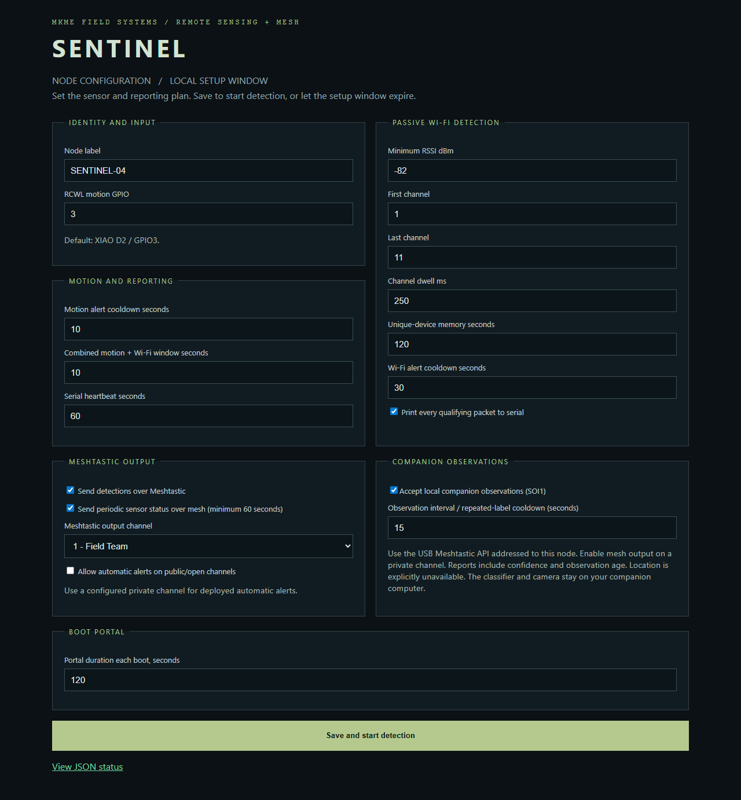
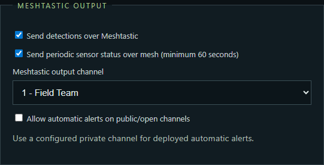
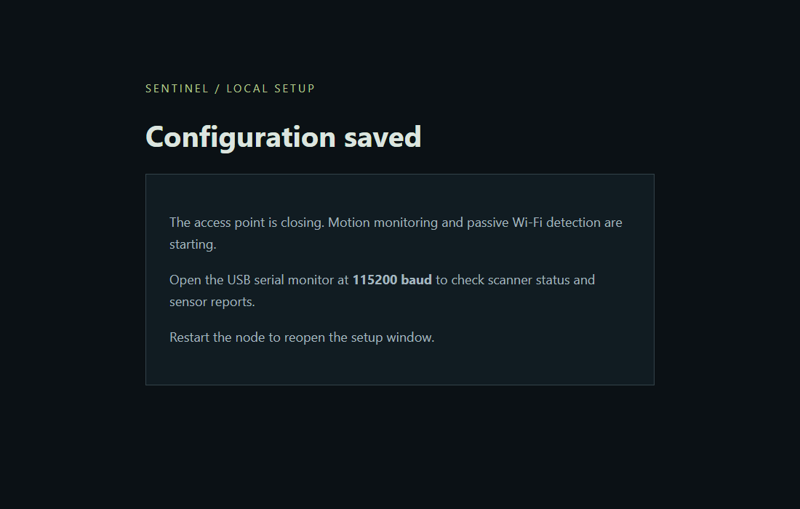

# Sentinel Ground — Presence firmware

Standalone local sensing for **XIAO ESP32-S3 + Wio-SX1262 B2B**: RCWL-0516 motion, passive Wi-Fi activity, Meshtastic alerts, optional status reports and local companion observations. No internet is needed for setup or use.

## Wire and configure

1. Connect RCWL VIN to the appropriate 5 V supply, GND to GND and OUT to **D2 / GPIO3**. GPIO4 is the alternate configurable input. Use a suitable regulated supply and attach the correct radio antenna.
2. Configure region, private channel key and radio role using the Meshtastic app over Bluetooth. Disable Meshtastic Wi-Fi networking; the passive scanner owns Wi-Fi.
3. Restart and join **SENTINEL-xxxx** during the 120-second setup window. The factory setup password is `sentinel123`. Open `http://192.168.4.1`.



*Current firmware renderer with example values and simulated channel state. Set label, motion GPIO and detection thresholds.*

4. Select the configured output channel and enable detections. Optional periodic sensor status has a minimum 60-second interval. Public/open channels require explicit opt-in; companion observations always require a private channel.



*Select an existing channel. Configure its key through the Meshtastic app.*

5. Select **Save and start detection**, then inspect USB diagnostics at **115200 baud**. Restart to reopen setup. Settings persist in flash.



*The access point closes and sensing starts. Confirm the alert arrives at your receiving node.*

Wi-Fi observations indicate radio activity, not a person count or verified identity. Mount motion sensors stationary and test their warm-up and environment. Sentinel is an awareness aid; do not connect sensor outputs to hazardous loads.

## Companion observations

Use the local USB Meshtastic API and the [SOI1 contract](OBSERVATIONS.md). Input is disabled by default. Reports contain label, confidence, count and age; location is explicitly unavailable. The classifier and images stay on your companion computer.

## Build locally

Use the existing pinned Meshtastic checkout (`47e129f4bdec33a5012851aa3546073aa87d9254`), PlatformIO Espressif32 6.9.0, Arduino ESP32 2.0.17 and installed library cache. `prepare.py --source <path> --platform <path>` accepts alternate local paths. No dependencies are downloaded by these scripts.

```powershell
.\firmware\SentinelPresenceMeshtastic\build.ps1
```

Target: **sentinel-ground-xiao-s3**. Output: **artifacts-ground/** with SHA-256 records. Build staging: `.build-ground/meshtastic`. Use only this target's new output when flashing Sentinel Ground; older `artifacts/` files may contain previous firmware. Follow [build and flash](../../wiki/Build-and-Flash.md) and back up radio settings first.

The overlay is the maintained source. `tests/run_tests.py` runs local native regressions. Preserve GPL-3.0 notices and corresponding source when distributing Meshtastic-based firmware.
