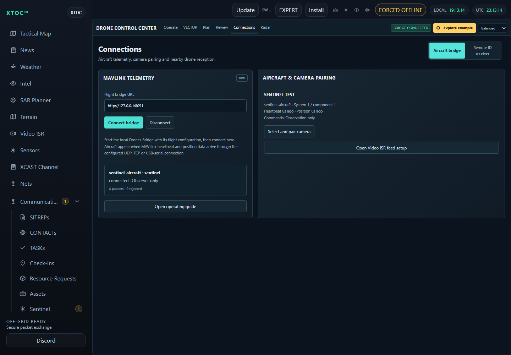

# Sentinel Presence / XIAO ESP32-S3

Remote sensing and Meshtastic relay firmware for the **Seeed Studio XIAO ESP32-S3 with Wio-SX1262 B2B LoRa board**. The XIAO radio pin mapping must match this assembly; a board with a different SX1262 wiring arrangement needs its own variant.

## Connect the sensor

| RCWL-0516 | XIAO |
| --- | --- |
| VIN | 5V |
| GND | GND |
| OUT | D2 / GPIO3, default |

GPIO4 / D3 is the alternate portal choice. GPIO5/6 are reserved for I²C; GPIO7/8/9 and 38–42 serve the radio, and 43/44 are reserved for GPS in this board variant. Do not attach a sensor output to those pins. Use a regulated, suitable supply and fit the correct LoRa antenna before transmission.

## Boot setup

Join `SENTINEL-xxxx`, password `sentinel123`, and open `http://192.168.4.1` within 120 seconds of startup. The setup page is entirely local. Use the Meshtastic Bluetooth app to configure the radio region, modem preset, channel keys and role; the Sentinel portal selects an already-configured output channel.


*Source-rendered firmware UI with simulated channel state. [Phone layout](../../assets/presence/setup-mobile.png).*

Choose the node label, motion GPIO, RSSI threshold, Wi-Fi scan range, channel dwell, duplicate memory interval, alert cooldowns, combined-detection window, heartbeat and boot setup duration. The scanner uses randomized/local unicast transmitter addresses, keeps temporary hashes in RAM and outputs no MAC addresses, SSIDs or packet contents.


*Enable sensor alerts, select a channel, and optionally enable periodic sensor status. Example channel names are shown.*

Save to persist settings and start detection. A failed save keeps the portal open. Otherwise the portal closes automatically when its boot window expires. The dedicated target owns Wi-Fi: normal Meshtastic Wi-Fi networking, its web server, Paxcounter and the separate Detection Sensor module are excluded or disabled so they cannot compete with Sentinel. Bluetooth remains available.


*After saving, inspect USB output for scanner startup and any errors. The confirmation screen alone is not a sensor or radio reception test.*

## Reporting

- USB: `115200` baud; configuration, motion transitions, Wi-Fi RSSI/channel, unique observations, mesh submission decisions, scanner health and queue drops. Verbose mode prints each queued qualifying Wi-Fi observation; compact mode prints new observations and health/events.
- Mesh: readable `TEXT_MESSAGE_APP` messages on the selected channel. Public/open or well-known-key channels require explicit opt-in. Disabled channels, unset RF region and disabled TX block Sentinel transmissions.
- Periodic sensor reports: optional, off by default, and no faster than once per 60 seconds. The serial heartbeat interval controls this cadence with that minimum. `WIFI` is a cumulative deduplicated observation count, not a count of people or currently present devices.
- Relay: normal Meshtastic forwarding, governed by the device's role and radio configuration. Turning off Sentinel reports does not disable standard Meshtastic traffic.
- USB logging is a human-readable diagnostic stream. Use Bluetooth for Meshtastic configuration; do not mix a binary serial API client with these raw diagnostic lines.

The node detects Wi-Fi activity, including activity outside the immediate mounting location. A silent device can remain undetected. Use motion sensing while stationary or landed. The optional MAVLink bridge forwards supported external telemetry. The legacy telemetry mode has no command path; the separate paired flight-controller mode below adds supervised XTOC requests. No camera acquisition or onboard GPS driver is added.

This is a continuous receiver: automatic idle sleep is disabled while explicit shutdown and the upstream low-battery handling remain available. Size the supply for continuous Wi-Fi, Bluetooth and LoRa operation rather than a sleeping sensor's duty cycle.

## MAVLink serial / mesh bridge

The boot portal offers independent **Serial RX to mesh** and **Mesh to serial TX** switches. Both default off, including when migrating existing Presence settings. Sensor reporting remains independently configurable. Existing saved sensor settings are retained through the `config3`/`config4`/`config5` to `config6` migration; new flight forwarding defaults off.


*Actual firmware page rendered with simulated settings; [full-size controls](../../assets/presence/mavlink-bridge.png).*

| Connection | Sentinel header | Connect to |
| --- | --- | --- |
| Telemetry input | D7 / GPIO44 / UART RX | Telemetry device TX |
| Telemetry output | D6 / GPIO43 / UART TX | Telemetry device RX |
| Reference | GND | Device signal GND |

Use **3.3 V TTL**, not RS-232 or a 5 V signal. UART is 8N1; choose 9600, 19200, 38400, 57600 (default), or 115200 baud. Only the wires needed by the enabled direction are required. USB retains 115200-baud diagnostics. This dedicated target disables upstream GPS and generic Serial modules because they can compete for UART/pins; Bluetooth configuration remains available.

1. Configure the same private Meshtastic channel/key and compatible RF settings on both nodes. Select the correct **local channel index** in each bridge portal (indices can differ between nodes).
2. On the source node, enable **Serial RX to mesh** and set baud to match the telemetry source. On the receiver, enable **Mesh to serial TX** and match its connected consumer's baud. Enable both switches for two-way telemetry exchange.
3. Choose a mesh send interval from 1000–60000 ms; default 5000 ms. Only one frame is submitted per interval across all types. The latest frame of each type replaces older pending samples, with round-robin selection to avoid starving lower-rate types. Pending observations older than 30 seconds are discarded. Use conservative rates for the configured LoRa preset and network capacity.
4. Save and allow the boot portal to close. USB prints UART configuration and periodic `mesh_submitted`, `serial_frames`, and `dropped_or_replaced` counters. Submission does not prove delivery.
5. Bench-test two nodes with a known telemetry source and consumer. Check received values and frame bytes, disabled directions, mismatched channels, disconnected UART, reconnect, and cold restart before installation. Physical UART and over-air acceptance remain pending.

Supported telemetry (MAVLink IDs): HEARTBEAT (0), SYS_STATUS (1), GPS_RAW_INT (24), ATTITUDE (30), GLOBAL_POSITION_INT (33). MAVLink 1 and 2 are accepted, including MAVLink 2 truncated payloads and signed frames. The bridge checks framing, supported length, incompatibility flags and CRC-extra. It does not hold signing secrets or authenticate signatures; the receiving MAVLink endpoint must enforce its own signature/replay policy. Original frame bytes are preserved, so this bridge does not regenerate signatures or timestamps. Delayed signed messages may be rejected by that endpoint.

Transport: Meshtastic `PRIVATE_APP` port 256, payload ASCII `SMV1` followed by exactly one complete supported MAVLink frame. No text/base64 wrapping or fragmentation. The largest supported frame is 77 bytes (signed GPS_RAW_INT), fitting one mesh payload. Both ends must implement this format. Unrelated private-port payloads and text messages are ignored. Broadcast frames on the chosen channel can reach any enabled bridge sharing its key; use a dedicated channel for each intended group. Public/default-key, disabled or unconfigured channels are blocked. RF TX must also be enabled for serial-to-mesh forwarding.

CRC-invalid, unsupported and flight-command frames are discarded. The serial parser has bounded storage and a 250 ms partial-frame timeout. Mesh-to-UART uses a bounded queue and nonblocking writes; overflow is dropped. A bounded 30-second exact-frame cache suppresses duplicate and immediate echo forwarding. This is best-effort telemetry, with no delivery guarantee, command path, mission/parameter transfer, or replacement for an aircraft's control link.

## MAVLink locations as Sentinel packets

Enable **XTOC Sentinel locations** to publish position-only `T=11` reports. This is independent of sensor alerts and the raw MAVLink forwarding switches; all three functions default off.


*Actual firmware setup renderer with simulated settings. Choose Serial UART or Mesh SMV1 input; Off is the factory default.*

1. Set the node label, for example `WRAITH-01` or `GROUND-01`. Select a private **Meshtastic output** channel. The location converter blocks public/default-key channels even if public sensor alerts are enabled.
2. Choose **Serial MAVLink** for an attached telemetry source. Connect its 3.3 V TX to D7/GPIO44 and common ground; match the bridge baud setting. Neither raw bridge switch needs to be on for conversion.
3. Alternatively choose **Mesh MAVLink (SMV1)**, select the bridge input channel and enter the originating Meshtastic node's eight hexadecimal digits without `!`. The upstream node must send supported `SMV1` MAVLink frames. Only this selected sender is converted; UART output can remain off. The raw bridge sends one frame per aggregate interval: five active types at the default five-second interval can leave 25 seconds between GPS frames. Reduce the source stream to the needed types or select a suitable faster bridge interval within the mesh capacity, and verify `fresh_fix` stays current.
4. Match MAVLink system/component IDs (both default 1). Set the report interval, default 15 seconds, range 5–3600 seconds. Enable conversion at one endpoint per source to avoid duplicate reports.
5. Save and let the portal close. Supply a continuing `GPS_RAW_INT` stream with a 3D-or-better fix. Both position and fix must be less than 15 seconds old. `GLOBAL_POSITION_INT` can update coordinates only while that GPS fix is fresh. Unknown UTC, invalid coordinates, lost fix or stale telemetry suppress reporting. UTC comes from the Meshtastic clock or a valid GPS epoch timestamp; boot-relative time is not UTC.
6. Connect XTOC to the receiving mesh and enable incoming packet auto-import. Reports use the existing Sentinel decoder and appear as Sentinel data. Verify the label, stable node ID and location before deployment. Use the label to identify the carried platform; this packet does not invent a drone/entity-type field.

The serial source uses this node's Meshtastic ID; mesh conversion preserves the selected originating node's ID. Each report is `X1.11.C.<packet-id>.1/1.<payload>` on `TEXT_MESSAGE_APP`, with Sentinel v1 location, UTC minute, label and **zero sensor readings**. Mode C is application-level clear encoding, carried over the configured private Meshtastic channel; it is not X Suite mode S. Incoming text is not fed back into the MAVLink converter.

USB diagnostics at 115200 baud include `position_submitted`, `position_reports`, `fresh_fix` and `UTC`. A submission is not proof of delivery. Native extraction, actual bridge-path tests and the actual XTOC codec contract pass; physical UART, over-air reception and live XTOC import still require a two-node bench test.

## Paired flight-controller link

Connect an aircraft flight controller through Sentinel to a USB ground node and XTOC:

`XTOC Drones -> local Drones Bridge -> USB ground node -> LoRa -> aircraft Sentinel -> flight-controller UART`

Telemetry and autopilot acknowledgements return along the reverse path. When a signing key is configured and the USB radio is ready, the helper sends a signed GCS heartbeat every two seconds. This indicates that the helper/link is alive, not that an operator holds control; preserve and bench-test the controller's own GCS/RC loss policies. This mode supports XTOC Hold, Resume, Return home and mission read/upload; it does not add arm/takeoff controls, RC override, joystick control, parameter writes or continuous VECTOR velocity guidance. Keep the aircraft's established pilot link and onboard loss-of-link behavior.


*Current firmware setup renderer with simulated settings. Enable this section on the aircraft node only; it defaults off.*

1. Configure matching RF settings and a dedicated private channel on both nodes. Use a direct link and a suitable fast preset; shared, congested or slow mesh links may not maintain the required freshness. Do not disable regional airtime limits.
2. Connect flight-controller TX to Sentinel D7/GPIO44 RX, flight-controller RX to D6/GPIO43 TX, and common ground. Use 3.3 V TTL and matching 8N1 baud. Enable **Aircraft flight-controller link**, enter the ground node's eight hexadecimal ID digits, select the private channel and the controller's MAVLink system/component IDs. Disable both legacy telemetry bridge switches.
3. Set the minimum downlink interval (250–2000 ms, default 1000). Heartbeats are prioritized at two-second intervals when available; mission replies/ACKs take priority. Telemetry uses latest samples, while a bounded queue preserves mission responses. Supply heartbeat, GPS_RAW_INT and GLOBAL_POSITION_INT continuously; select other streams to fit the radio capacity. Rate scheduling is not a delivery guarantee.
4. Configure MAVLink 2 signing on the flight controller and require valid signed requests there. Use the same key in the private XTOC Drones Bridge configuration. Sentinel preserves signatures but does not authenticate them; the endpoint does. Set the PC clock correctly and provide UTC on the aircraft from Meshtastic or GPS_RAW_INT epoch time. Frames older than five seconds or more than two seconds ahead are rejected. Boot-relative GPS timestamps are not UTC.
5. Plug the ground node into the PC by USB. Leave its aircraft link and legacy UART switches **off**. The Drones Bridge owns its USB Meshtastic API connection at 115200 baud; close Serial Monitor and other clients using that COM port. Use Bluetooth to configure the radio. A standard compatible Meshtastic ground node can also serve this role.
6. Use the XTOC helper's **sentinel** transport configuration below, replacing example IDs and COM port. Start the helper with `--flight-config` pointing to your private JSON file. In XTOC **Drones -> Connections -> Aircraft bridge**, connect to `http://127.0.0.1:8091`. Verify the aircraft identity, heartbeat age and actual coordinates.

```json
{
  "links": [{
    "id": "sentinel-aircraft",
    "transport": "sentinel",
    "device": "COM7",
    "baud": 115200,
    "peerNode": 270544960,
    "channel": 0,
    "systemId": 1,
    "componentId": 1,
    "trustedForControl": false,
    "commands": [],
    "missionWrite": false,
    "sentinelReports": true,
    "sentinelChannel": 0
  }],
  "operators": []
}
```

`peerNode` is the **aircraft** Meshtastic ID as a decimal integer: the example equals hex `10203040`. The portal's paired ID is the **ground** node. Channel indices are local and may differ between nodes. The helper reads the ground radio's configuration and requires a private channel before use; it never writes its keys, region or RF configuration.

For control or mission reads, add the aircraft's `signingKeyHex` to the private link configuration. For control, set `trustedForControl: true`, allow the required `commands` (`hold`, `resume`, `rtl`), and enable `missionWrite` only when needed. Configure a scoped operator record using the existing XTOC Drones Bridge authority instructions. Enter the credential in XTOC, acquire control, review the exact aircraft and explicitly confirm each action. Missing signing, authority or fresh heartbeat blocks control. The example grants no control permission.

Mission upload requires a fresh disarmed aircraft; acceptance is followed by readback. A received ACK means acknowledgement, not proven movement. No command is automatically retried after a timeout or reconnect. Reconnect requires a fresh heartbeat and newly acquired control. Keep missions small enough for the existing 10-second per-step / 120-second overall transfer timeouts and 60-second operator lease; use the normal direct setup connection for larger transfers.

The wire format is `PRIVATE_APP` port 256: `SMF1` + four-byte little-endian UTC seconds + one complete supported MAVLink frame. Paired unicast uses zero relay hops and no radio ACK request. Commands require source 255/190, the configured target system/component, a signed frame and the intended ground sender. MQTT arrivals, broadcast requests, unsupported messages and duplicates are discarded. No frame fragmentation or forwarding into the legacy `SMV1` path occurs.

Optional `T=11` location reporting remains available using **Serial MAVLink** as the position source. Set `sentinelReports: true` and the ground radio's local `sentinelChannel` in the helper link configuration to carry those packets through the same USB connection. Enable XTOC's mesh auto-import setting. Only single-part clear Sentinel reports whose embedded node ID matches the paired aircraft are imported; this grants no flight-control authority. Flight telemetry also appears independently in XTOC's aircraft controls. Choose a suitable report interval to conserve radio capacity. Camera video uses its separate Video ISR link.

Before use, bench-test with propulsion disabled: correct identities, signed heartbeat/position, Hold/Resume/RTL acknowledgements, mission readback, rejected wrong sender/channel, disconnected UART, loss of LoRa, expired authority, cold restart and recovery. Verify the controller's actual signature rejection and onboard failsafe behavior.



*Current XTOC interface with simulated aircraft telemetry and Sentinel import. Configure the bridge before acquiring flight-control authority.*

## Local build

The supported local build uses Meshtastic revision `47e129f4bdec33a5012851aa3546073aa87d9254`, the installed PlatformIO Espressif32 6.9.0 platform, Arduino ESP32 2.0.17 and the existing Meshtastic library cache. It does not download a replacement toolchain or alter the source checkout. The application is GPL-3.0, including upstream Meshtastic; preserve its source and notices when distributing binaries.

From this repository:

```powershell
.\firmware\SentinelPresenceMeshtastic\build.ps1
```

`prepare.py` expects the existing source at `C:/GitHub/lilygo/meshtastic-firmware` and libraries in its `.pio/libdeps/t-watch-s3` cache. It accepts `--source` and `--platform` for another installed location. An absent or mismatched source stops preparation. The generated `.build` tree is disposable; keep the overlay and build scripts as source.

Successful builds export application, factory and filesystem images plus symbols and hashes to `artifacts/`. The factory image includes bootloader/partition/application sections; use the exported Meshtastic manifest to select addresses and any required filesystem image. Never flash an arbitrary image at an assumed offset or erase an existing node's settings without a backup and explicit authorization.

Native logic checks and source-rendered setup previews:

```powershell
g++ -std=c++17 tests/core_test.cpp -o .build/core_test.exe
g++ -std=c++17 tests/mavlink_test.cpp -o .build/mavlink_test.exe
.\.build\mavlink_test.exe
.\.build\core_test.exe
g++ -std=c++17 tests/position_test.cpp -o .build/position_test.exe
.\.build\position_test.exe | Tee-Object .build/position-fixture.txt
node tests/xtoc_position_contract.cjs .build/position-fixture.txt
python tests/bridge_integration.py
python tests/render_portal.py
```

Run these commands from this firmware directory. UI capture tooling uses the already-installed local Playwright package; the firmware itself has no browser package dependency.

## Source and licensing

The build overlays `overlay/src/modules/optional/SentinelPresence` and adds its setup call to the pinned Meshtastic module registry in the generated tree. The maintained upstream checkout remains untouched. The build's local Nanopb runtime uses Meshtastic's committed generated protobuf files, without invoking its optional Python generator installer.

See [LICENSE](LICENSE) for firmware licensing and preserve the upstream dependency notices. The repository's original standalone examples retain their existing licence.
