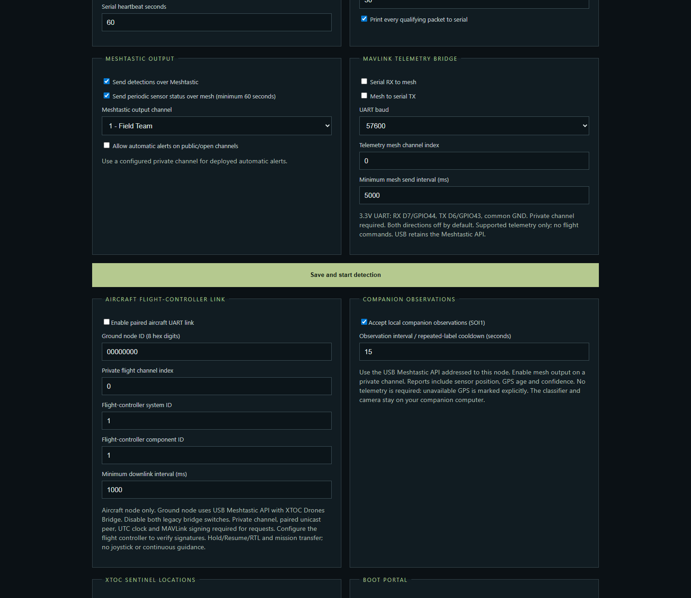
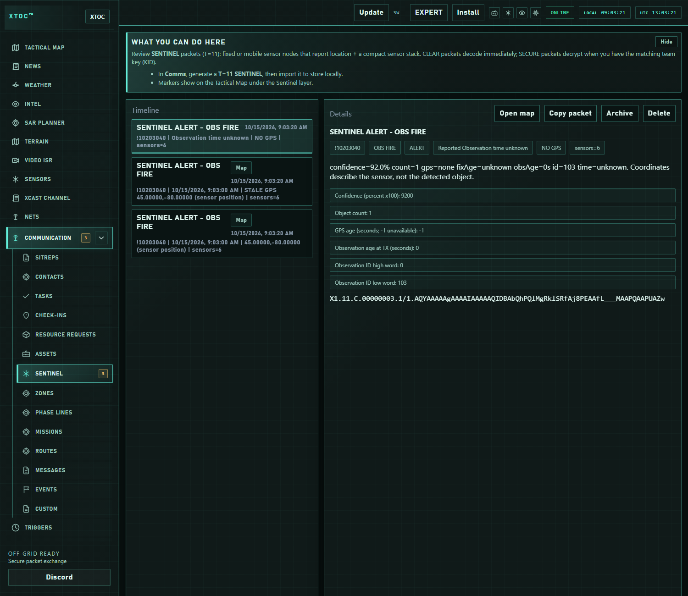
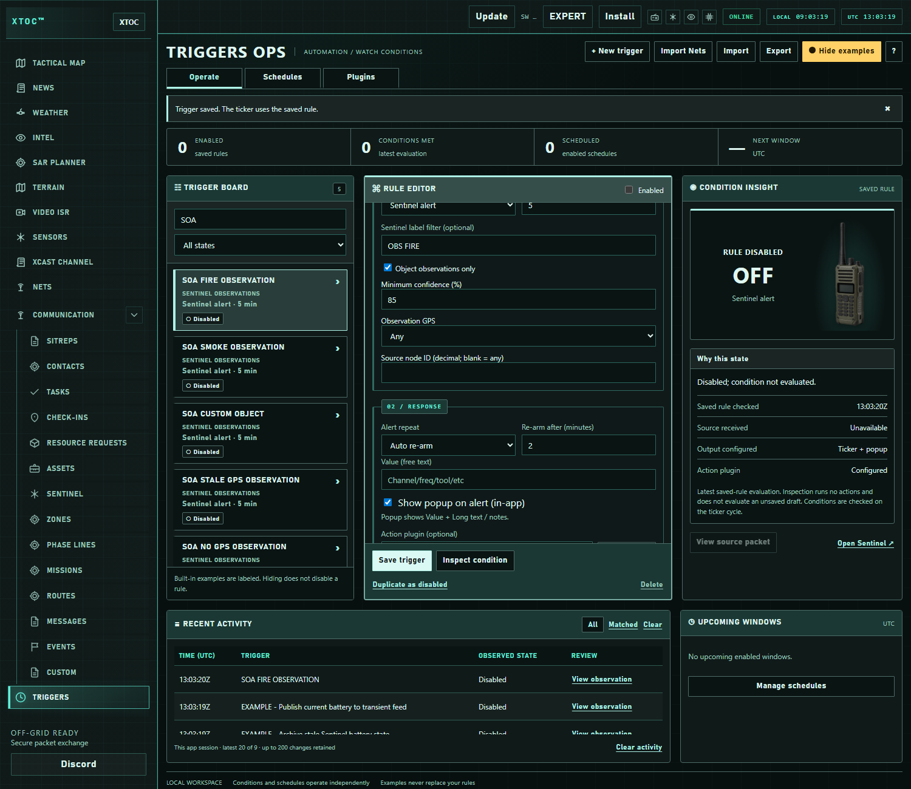

# Companion observation input

Send a small classifier result from your own Pi or other computer to Sentinel. The ESP adds available MAVLink sensor position and transmits an ordinary T=11 Sentinel alert. Implement your own camera/model; the supplied example only encodes and submits observations.

## Wiring and setup

Connect the companion USB host to the ESP's USB data connection. On Pi Zero use its USB data/OTG port with a host adapter, not the power-only port. Provide a suitable regulated supply. Leave the flight controller on RX GPIO44 / TX GPIO43 with matching baud and common ground; never tie two devices' TX outputs together.

In the Sentinel boot portal enable **Accept local companion observations (SOI1)**, mesh output and a configured private mesh channel. Observation interval / repeated-label cooldown defaults to 15 seconds (5–3600). Input is off by default and stored separately from existing flight settings. Use **Serial MAVLink** for sensor positioning, or the enabled aircraft link's controller identity. No telemetry is required to submit an observation.



*Actual firmware setup with simulated settings. Enable local input and private mesh output.*

USB retains the Meshtastic API. Local client API access is the trust boundary: protect USB access and any enabled local BLE/network client access. The hook consumes SOI submissions before routing; remote LoRa/MQTT packets cannot invoke it. Raw serial text is not accepted. The input never carries flight commands.

## Input contract: SOI1

Use a Meshtastic `ToRadio.packet` decoded payload, `PRIVATE_APP` port **256**, addressed to **this ESP's own node number**, with ACK and response requests off. All numeric input fields are little-endian.

| Offset | Field | Meaning |
|---|---|---|
| 0–3 | `SOI1` | Four ASCII bytes identifying version 1 |
| 4–7 | observation ID, uint32 | Nonzero; new event = new ID |
| 8–9 | confidence, uint16 | 0–10000; 9200 means 92% |
| 10–11 | count, uint16 | 1–32767 |
| 12–13 | age in milliseconds, uint16 | 0–5000 since classifier observation |
| 14 | label length, uint8 | 1–24 |
| 15 onward | label | Uppercase A–Z, digits, underscore or hyphen; exact length |

Maximum input is 39 bytes. Do not send images, long text or arbitrary JSON. Frames with invalid fields, wrong destination, unsupported SOI version, disabled input or active setup portal are consumed/rejected, not relayed as observations. Other Meshtastic API traffic keeps its existing behavior.

The generic [sender example](../firmware/SentinelPresenceMeshtastic/examples/send_observation.py) uses the Meshtastic Python client on the companion. Call its `encode()` function from your classifier, or submit a manual test:

```sh
python send_observation.py --port /dev/ttyACM0 --label FIRE --confidence 92 --count 1
```

Use the device path assigned to your ESP; some USB adapters use `/dev/ttyUSB0`. Run only one client on that port. An observation ID is deduplicated for 60 seconds while retained in the 16-entry recent cache; same-label cooldown follows the configured interval. The four-entry pending queue drops overflow and expires reports after 30 seconds. Flight requests/responses are serviced first, and observations wait at least 250 ms after a flight downlink. This is bounded best-effort reporting, not guaranteed delivery or a radio airtime reservation.

## Position and clock

Sentinel snapshots the latest usable controller position when it accepts input. It does not interpolate a historical camera location. The source age records the classifier-to-input delay. A fix under 15 seconds old is fresh; otherwise the last valid fix is stale. A bad GPS fix removes the usable position. With no fix, the report explicitly has no location. The node's UTC clock, or recent controller UTC, supplies observation time; without UTC, time is marked unknown and the report still sends. GPS acquisition and UTC validity are separate.

Position is **sensor origin**, not detected-object geolocation. Neither zero coordinates nor a fabricated epoch substitute for missing data. Queue delay increments transmitted fix/observation age and can downgrade a fresh snapshot to stale. Ages saturate at 32767 seconds; treat that value as at least that age.

## Mesh output: existing Sentinel v1 / T=11

Envelope: `X1.11.C.<packet-id>.1/1.<base64url>`, sent as Meshtastic `TEXT_MESSAGE_APP` on the configured private mesh-output channel. Output is always one bounded packet, with no radio ACK request. The regular T=11 node ID is the ESP's own identity; label is `OBS ` followed by the submitted class. Alert is set. The outer clear format is not application-level authentication; the configured mesh channel supplies its usual radio protection.

The existing 19-byte v1 header and optional label are retained. New flag bits: **3 no location**, **4 stale location**, **5 unknown UTC**, **6 object observation**. No-location coordinate storage uses signed INT32_MIN for both E5 fields; supporting receivers suppress the map position. Unknown UTC uses zero in the time field and bit 5. Older receivers require an update for these quality semantics; unchanged legacy reports remain unchanged.

Six sensor readings carry observation metadata (existing one-byte type + signed big-endian int16 value):

| Type | Meaning |
|---|---|
| 240 | Confidence percent ×100 |
| 241 | Count |
| 242 | GPS age seconds; -1 = no usable position |
| 243 | Observation age seconds at mesh submission |
| 244 | Observation ID high 16 bits, interpreted unsigned |
| 245 | Observation ID low 16 bits, interpreted unsigned |

Use the updated XTOC Sentinel view and mesh auto-import. A shared XTOC Drones Bridge ground connection can carry these packets with `sentinelReports` enabled. XTOC XPASS **Sentinel Object Observation Alerts** installs five disabled SOA trigger templates and two disabled local plugin examples. Configure source, class, confidence and GPS filters in Triggers, enable and save. A source filter is not independent proof of identity. Review observations before consequential actions.

Diagnostic heartbeat counters report accepted, rejected, duplicate, dropped, sent and queued observations. “Sent” means submitted to the mesh stack, not received by the ground operator. Camera video remains on its separate link or local storage.




*Current XTOC with simulated observations. Missing GPS is shown explicitly and has no map position.*



*Current XTOC with example settings. Configure the source, label and confidence, then enable and save the rule.*

## Operator walkthrough

1. Run the manual sender once with a clearly named test class and verify the received report in XTOC Sentinel.
2. Repeat without telemetry; expect NO GPS and no map point.
3. Supply valid MAVLink position and compare sensor coordinates. Stop the stream and confirm an older usable fix becomes stale. An invalid fix clears location.
4. Acquire **Sentinel Object Observation Alerts** in XTOC XPASS. In **Triggers**, search **SOA**, edit the desired rule, configure source/class/confidence/GPS filters, enable and save. Five templates cover fire, smoke, custom object, stale GPS and no GPS. Two disabled local plugin examples cover observation records and location review.
5. Send a new matching observation after cooldown and confirm the intended alert. Test a nonmatching class as well.

Initial XPASS acquisition needs online authorization. Installed authorized content continues offline across restarts. Your own code supplies camera and classifier functions. See the illustrated companion guide in the [Training Hub](https://store.mkme.org/training/).
