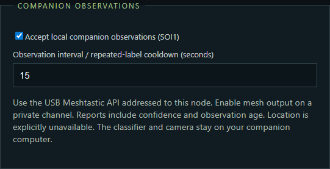
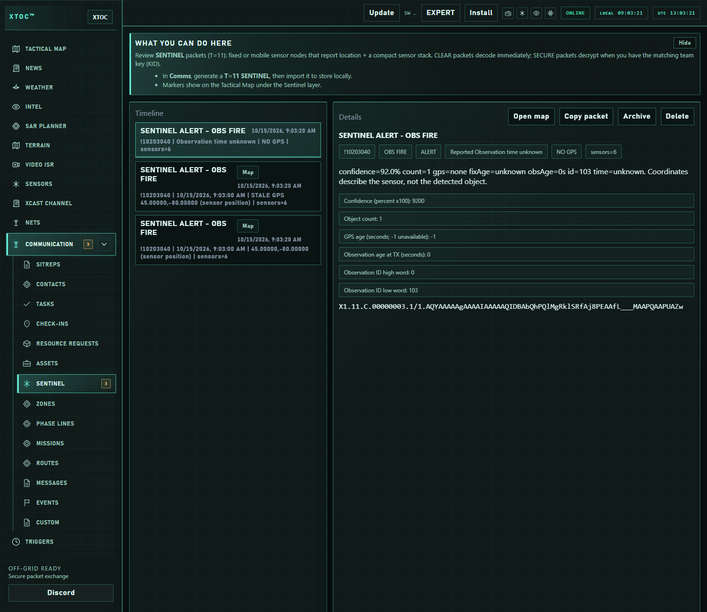

# Local companion observations

Connect your companion computer to the node's USB data port. Run one Meshtastic API client on that port; the classifier and camera remain on the computer.

1. Open the Sentinel boot portal and select **Accept local companion observations (SOI1)**.
2. Enable mesh output on a configured private channel and select the reporting interval.

*Current firmware renderer with simulated settings. Input defaults off on a new node.*

3. Save and start detection. Submit observations with the [generic sender and SOI1 contract](../firmware/SentinelPresenceMeshtastic/OBSERVATIONS.md).
4. Enable mesh auto-import in the updated XTOC receiver and check the report.

*Simulated XTOC observations. Local reports explicitly mark location unavailable; missing UTC is marked unknown.*

Protect local USB/BLE client access. Remote mesh packets cannot invoke local observation input. Submission counters do not prove reception; verify the receiving node.
