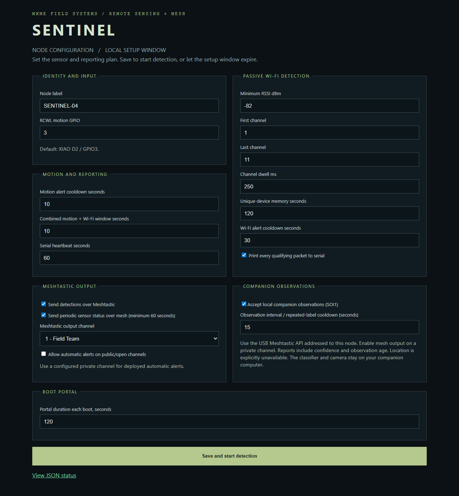

# Configuration reference

Open `http://192.168.4.1` while connected to SENTINEL-xxxx during the boot setup window.

| Setting | Default / range |
|---|---|
| Label | SENTINEL-1, up to 24 letters, digits, spaces, hyphens or underscores |
| Motion GPIO | 3 (D2), alternate 4 (D3) |
| Minimum Wi-Fi RSSI | -82 dBm; -100 to -20 |
| Wi-Fi channels | 1–11 |
| Channel dwell | 250 ms; 100–2000 |
| Unique-device memory | 120 seconds; 10–3600 |
| Wi-Fi cooldown | 30 seconds; 5–3600 |
| Motion cooldown | 10 seconds; 2–3600 |
| Combined window | 10 seconds; 1–300 |
| Serial heartbeat | 60 seconds; 10–3600 |
| Mesh output | On, channel 0; select configured channel 0–7 |
| Public-channel opt-in | Off |
| Periodic mesh status | Off; minimum 60 seconds when enabled |
| Companion observations | Off; interval 15 seconds, range 5–3600 |
| Setup window | 120 seconds; 15–600 |

*Actual firmware renderer with simulated settings. Channel keys and RF region are configured in the Meshtastic app.*

Save and restart to check persistence. USB diagnostics use 115200 baud.
