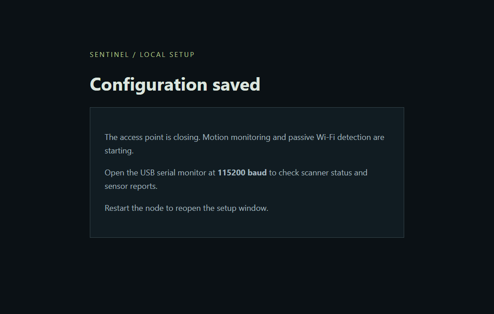

# Deployment and troubleshooting

## Commission the installed node

Record board variant, firmware version, label, ID, role, channel, supply and placement. Confirm reception from the installed position, then test cold restart, power interruption and transport loss. Keep a manual check-in/fallback process.

Secure cables, antenna and enclosure. Measure supply during transmission and size for continuous Wi-Fi/Bluetooth/LoRa operation, not a sleeping sensor duty cycle.

## Find the failing stage

| Symptom | Check |
|---|---|
| No setup network | Restart within the boot window; check supply and USB boot log |
| No Wi-Fi observations | Check scanner health, channel range, RSSI threshold and nearby qualifying traffic |
| Motion always active | Let the sensor warm up, check GPIO wiring and mount it stationary |
| No mesh alert | Confirm output enabled, selected channel, matching private key, region and TX |
| No companion report | Confirm local input enabled, correct destination node and one USB API client |
| Text arrives but no Sentinel row | Ordinary motion/Wi-Fi text is distinct from T=11 companion packets |

## Useful diagnostics

USB **115200 baud** provides scanner health, mesh decisions, `mesh_submitted` and observation accepted/rejected/duplicate/dropped/sent/queued counters. Submission is not receipt: compare with the receiving radio and XTOC record.

*Current firmware confirmation screen with simulated settings. Check USB diagnostics after saving.*

If delivery remains unreliable, simplify to two nearby nodes and one reporting function. Restore features one at a time while watching receipt and traffic.
