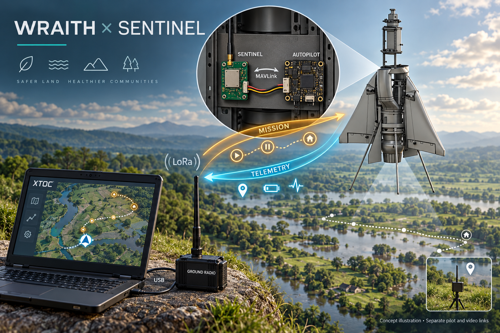

# Sentinel flight-controller link



*Wraith carrier illustration: mission requests travel to the aircraft; telemetry returns to XTOC. Pilot and video links remain separate.*

Connect an aircraft flight controller through Sentinel to a USB ground node and XTOC:

`XTOC Drones -> local Drones Bridge -> USB ground node -> LoRa -> aircraft Sentinel -> flight-controller UART`

Telemetry and autopilot acknowledgements return along the reverse path. When a signing key is configured and the USB radio is ready, the helper sends a signed GCS heartbeat every two seconds. This indicates that the helper/link is alive, not that an operator holds control; preserve and bench-test the controller's own GCS/RC loss policies. This mode supports XTOC Hold, Resume, Return home and mission read/upload; it does not add arm/takeoff controls, RC override, joystick control, parameter writes or continuous VECTOR velocity guidance. Keep the aircraft's established pilot link and onboard loss-of-link behavior.


*Current firmware setup renderer with simulated settings. Enable this section on the aircraft node only; it defaults off.*

1. Configure matching RF settings and a dedicated private channel on both nodes. Use a direct link and a suitable fast preset; shared, congested or slow mesh links may not maintain the required freshness. Do not disable regional airtime limits.
2. Connect flight-controller TX to Sentinel D7/GPIO44 RX, flight-controller RX to D6/GPIO43 TX, and common ground. Use 3.3 V TTL and matching 8N1 baud. Enable **Aircraft flight-controller link**, enter the ground node's eight hexadecimal ID digits, select the private channel and the controller's MAVLink system/component IDs. Disable both legacy telemetry bridge switches.
3. Set the minimum downlink interval (250–2000 ms, default 1000). Heartbeats are prioritized at two-second intervals when available; mission replies/ACKs take priority. Telemetry uses latest samples, while a bounded queue preserves mission responses. Supply heartbeat, GPS_RAW_INT and GLOBAL_POSITION_INT continuously; select other streams to fit the radio capacity. Rate scheduling is not a delivery guarantee.
4. Configure MAVLink 2 signing on the flight controller and require valid signed requests there. Use the same key in the private XTOC Drones Bridge configuration. Sentinel preserves signatures but does not authenticate them; the endpoint does. Set the PC clock correctly and provide UTC on the aircraft from Meshtastic or GPS_RAW_INT epoch time. Frames older than five seconds or more than two seconds ahead are rejected. Boot-relative GPS timestamps are not UTC.
5. Plug the ground node into the PC by USB. Leave its aircraft link and legacy UART switches **off**. The Drones Bridge owns its USB Meshtastic API connection at 115200 baud; close Serial Monitor and other clients using that COM port. Use Bluetooth to configure the radio. A standard compatible Meshtastic ground node can also serve this role.
6. Use the XTOC helper's **sentinel** transport configuration below, replacing example IDs and COM port. Start the helper with `--flight-config` pointing to your private JSON file. In XTOC **Drones -> Connections -> Aircraft bridge**, connect to `http://127.0.0.1:8091`. Verify the aircraft identity, heartbeat age and actual coordinates.

```json
{
  "links": [{
    "id": "sentinel-aircraft",
    "transport": "sentinel",
    "device": "COM7",
    "baud": 115200,
    "peerNode": 270544960,
    "channel": 0,
    "systemId": 1,
    "componentId": 1,
    "trustedForControl": false,
    "commands": [],
    "missionWrite": false,
    "sentinelReports": true,
    "sentinelChannel": 0
  }],
  "operators": []
}
```

`peerNode` is the **aircraft** Meshtastic ID as a decimal integer: the example equals hex `10203040`. The portal's paired ID is the **ground** node. Channel indices are local and may differ between nodes. The helper reads the ground radio's configuration and requires a private channel before use; it never writes its keys, region or RF configuration.

For control or mission reads, add the aircraft's `signingKeyHex` to the private link configuration. For control, set `trustedForControl: true`, allow the required `commands` (`hold`, `resume`, `rtl`), and enable `missionWrite` only when needed. Configure a scoped operator record using the [XTOC Drones Bridge authority instructions](https://github.com/MKme/XTOC/blob/main/drones-bridge/README.md). Enter the credential in XTOC, acquire control, review the exact aircraft and explicitly confirm each action. Missing signing, authority or fresh heartbeat blocks control. The example grants no control permission.

Mission upload requires a fresh disarmed aircraft; acceptance is followed by readback. A received ACK means acknowledgement, not proven movement. No command is automatically retried after a timeout or reconnect. Reconnect requires a fresh heartbeat and newly acquired control. Keep missions small enough for the existing 10-second per-step / 120-second overall transfer timeouts and 60-second operator lease; use the normal direct setup connection for larger transfers.

The wire format is `PRIVATE_APP` port 256: `SMF1` + four-byte little-endian UTC seconds + one complete supported MAVLink frame. Paired unicast uses zero relay hops and no radio ACK request. Commands require source 255/190, the configured target system/component, a signed frame and the intended ground sender. MQTT arrivals, broadcast requests, unsupported messages and duplicates are discarded. No frame fragmentation or forwarding into the legacy `SMV1` path occurs.

Optional `T=11` location reporting remains available using **Serial MAVLink** as the position source. Set `sentinelReports: true` and the ground radio's local `sentinelChannel` in the helper link configuration to carry those packets through the same USB connection. Enable XTOC's mesh auto-import setting. Only single-part clear Sentinel reports whose embedded node ID matches the paired aircraft are imported; this grants no flight-control authority. Flight telemetry also appears independently in XTOC's aircraft controls. Choose a suitable report interval to conserve radio capacity. Camera video uses its separate Video ISR link.

Before use, bench-test with propulsion disabled: correct identities, signed heartbeat/position, Hold/Resume/RTL acknowledgements, mission readback, rejected wrong sender/channel, disconnected UART, loss of LoRa, expired authority, cold restart and recovery. Verify the controller's actual signature rejection and onboard failsafe behavior.


*Current XTOC interface with simulated aircraft telemetry and Sentinel import. Configure the bridge before acquiring flight-control authority.*

[Wiring](Wiring-Reference.md) · [Troubleshooting](Deployment-and-Troubleshooting.md)
