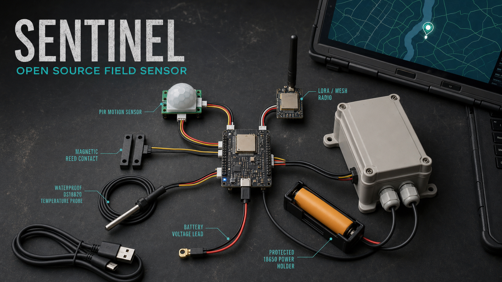

# Sentinel Wiki

## Choose your field role

The XIAO Presence target now supports RCWL motion, Wi-Fi activity, a two-way MAVLink bridge and MAVLink-derived Sentinel location reports for ground nodes and carried payloads.

[Presence, MAVLink and Sentinel location setup](Presence-and-MAVLink.md) includes current setup screenshots and validation steps.

Sentinel is an open-source field sensor for the MKME X Suite. XTOC and XCOM decode and display its reports, XINTEL provides local radio/SDR monitoring and packet ingest, and XCORE provides local AI-assisted analysis of XTOC/XCOM operational data. A node combines direct sensors, a controller, a transport, power, and an enclosure. Begin with one ESP32 and one PIR, prove a `T=11` packet end to end, then add only the sensing your mission requires.

*Concept illustration; component placement and map display are illustrative. Amber: mission actions. Cyan: returning telemetry. Separate pilot and video links.*

- **Aircraft supervision:** [Flight-controller setup](Flight-Controller-Link.md) for signed commands, missions and returning telemetry.
- **Ground sensing or telemetry relay:** [Presence and MAVLink setup](Presence-and-MAVLink.md).
- **Learn the packet format:** use the standalone Arduino examples below.

## Standalone sensor examples

1. [Parts and kits](Parts-and-Kits.md)
2. [Build the first node](Build-the-First-Node.md)
3. [Wiring reference](Wiring-Reference.md)
4. [XTOC/XCOM integration](XTOC-XCOM-Integration.md)
5. [Deployment and troubleshooting](Deployment-and-Troubleshooting.md)
6. [Packet and firmware notes](Packet-and-Firmware.md)

## X Suite projects

- [XTOC](https://github.com/MKme/XTOC) — command map, Sentinel review, triggers, and control composition
- [XCOM](https://github.com/MKme/xcom) — field packet composition, reception, mapping, and transport handoff
- [XINTEL](https://github.com/MKme/xintel) — local radio/SDR monitoring, transcription, and packet ingest
- [XCORE](https://github.com/MKme/xcore) — local AI-assisted summaries and operational analysis
- [XCAM](https://github.com/MKme/xcam) — local camera feeds and optional camera-motion Sentinel reports
- [XNODE](https://github.com/MKme/xnode) — wearable and keyboard field endpoints

Sentinel is not a certified life-safety or security system. Keep a human verification and fallback process.

## Direct aircraft supervision

Use the [paired flight-controller link](Flight-Controller-Link.md) for XTOC commands and returning telemetry through a USB ground node. This is separately enabled from the legacy telemetry bridge and T=11 position reporting.
