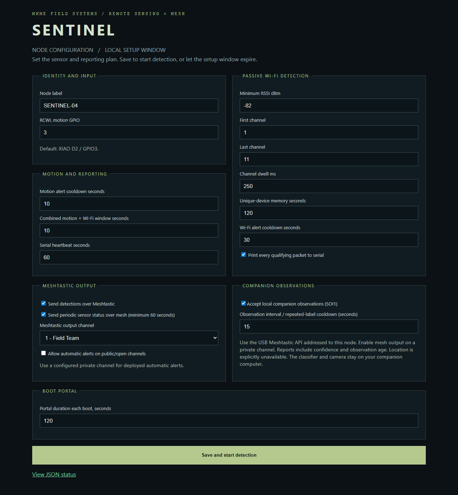

# Sentinel field guide

Build a stationary sensor with motion sensing, passive Wi-Fi detection and Meshtastic alerts. Optional local companion observations carry labels, confidence and counts.

1. Choose [parts](Parts-and-Kits.md) and follow [wiring](Wiring-Reference.md).
2. [Build and flash](Build-and-Flash.md), then [configure your first node](Build-the-First-Node.md).
3. Tune [Wi-Fi detection](Wi-Fi-Detection.md) and [settings](Configuration-Reference.md).
4. Connect [XTOC/XCOM](XTOC-XCOM-Integration.md), or add [companion observations](Companion-Observations.md).
5. Follow [deployment checks](Deployment-and-Troubleshooting.md).

*Firmware-rendered setup with simulated channel state. Save, then verify reception on a second node.*
