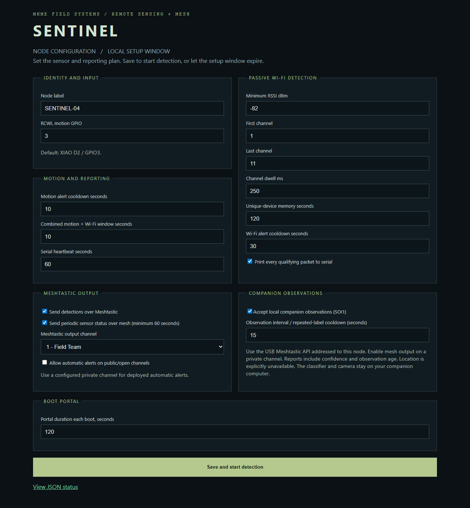

# Wiring reference

## Presence node

Use XIAO ESP32-S3 with the compatible Wio-SX1262 B2B board and correct antenna.

| RCWL-0516 | Connection |
|---|---|
| VIN | Suitable 5 V supply |
| GND | Common GND |
| OUT | D2 / GPIO3 (default), or D3 / GPIO4 when configured |

USB carries diagnostics at 115200 baud and the Meshtastic client API. A companion computer connects through USB data, with one API client owning the port. Verify supply voltage and board pin labels before powering.

*Firmware renderer with simulated settings. Match the selected GPIO to your wiring.*

The [standalone Arduino examples](Standalone-Examples.md) use their own board and pin definitions. Do not mix their wiring with the Presence target. Keep outputs away from mains and hazardous loads.
