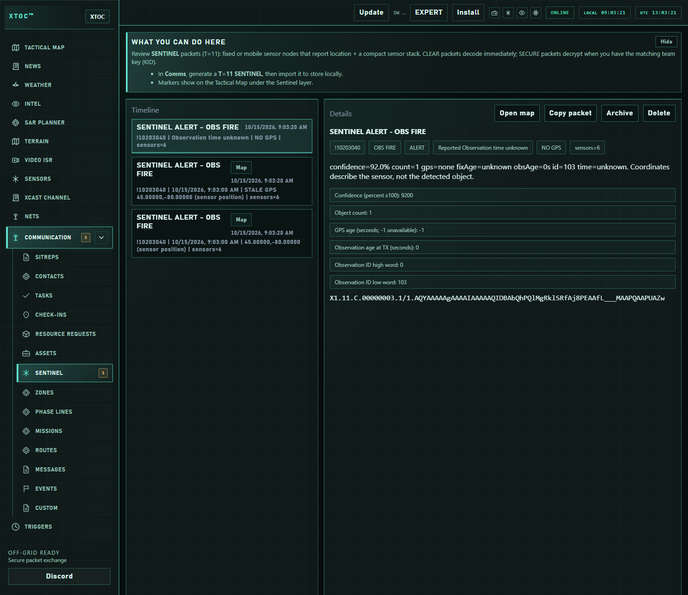
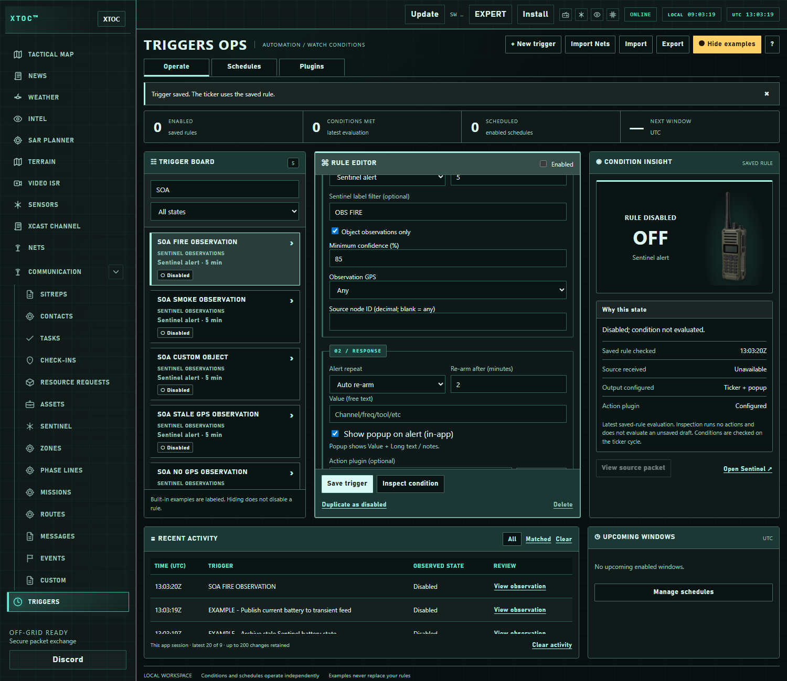

# XTOC and XCOM integration

The [Arduino example](Standalone-Examples.md) prints a complete `T=11 SENTINEL` packet. In XTOC or XCOM, open **Comms → Import/Export**, paste the full line and import it. Check Sentinel and the Tactical Map layer for the configured stationary position.

Presence motion/Wi-Fi alerts are readable Meshtastic text, not automatically T=11 data. [Companion observations](Companion-Observations.md) use T=11 and need an updated quality-aware receiver. In XTOC enable incoming mesh auto-import, then check the observation's label, confidence and count. Local companion reports have no location and do not invent map coordinates.

*XTOC with simulated observations. Missing GPS is shown explicitly.*

Optional XPASS Sentinel Object Observation Alerts supplies disabled SOA templates. Configure the source, label and confidence, enable and save the intended rule.

*XTOC with example rule settings. Source filters alone are not proof of identity.*
